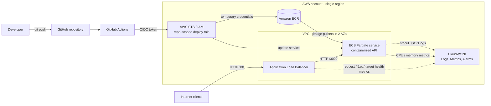

# Architecture

> **Status:** target design. Nothing described here has been deployed yet. Phase 1 only covers the local foundation (app, container, Terraform skeleton, CI). See [roadmap.md](roadmap.md).

## Goal

Run a small containerized HTTP API on AWS behind a load balancer, with the whole stack defined in Terraform and delivered by GitHub Actions authenticating to AWS through OIDC — no long-lived keys, no manual console changes, and everything destroyable on demand.

## Target architecture



Request path: **Internet → ALB → ECS Fargate task → API**.
Delivery path: **GitHub → GitHub Actions → OIDC/IAM → ECR → ECS Fargate**.

## Components and why each exists

| Component | Role | Why it is here |
|---|---|---|
| **Terraform** | Defines every AWS resource | Reproducible, reviewable, destroyable infrastructure. The lab must be rebuildable from the repo alone. |
| **GitHub Actions** | CI (now) and CD (Phase 5) | Same platform as the code; free tier is enough for a lab. |
| **GitHub OIDC + IAM role** | Lets workflows assume an AWS role | Replaces long-lived access keys with short-lived STS credentials scoped to this repository/branch. |
| **Amazon ECR** | Private container registry | Native image source for ECS, supports scan-on-push and lifecycle policies to cap storage. |
| **ECS Fargate** | Runs the container | Serverless containers: no EC2 hosts or cluster nodes to patch, and far simpler than Kubernetes for one service. |
| **Application Load Balancer** | Public entry point | Stable DNS name, health-checked routing to tasks, rolling deployments without downtime. |
| **CloudWatch Logs** | Container log sink | ECS `awslogs` driver ships stdout; the API already logs one JSON line per request. |
| **CloudWatch Metrics / Alarms** | Health signals | ALB 5xx, unhealthy target count, ECS CPU/memory — enough to detect a broken deploy. |
| **IAM** | Permissions boundary between all of the above | Separate task execution role, task role and deploy role, each least-privilege. |

## Networking decision: no NAT gateway

Fargate tasks run in **public subnets with a public IP**, but their security group only accepts traffic from the ALB's security group. This lets tasks pull images from ECR and write to CloudWatch without a NAT gateway, which would otherwise be one of the largest fixed costs of the lab (see [cost-strategy.md](cost-strategy.md)). The trade-off and the private-subnet alternative are discussed in [security.md](security.md).

## Health model

The API exposes two probes with different meanings:

- `GET /health` — **liveness**: the process is up. Used by the Docker `HEALTHCHECK` (and by an ECS container health check, which must be declared in the task definition — ECS ignores the Dockerfile `HEALTHCHECK`).
- `GET /ready` — **readiness**: the process is accepting traffic. Returns `503` before the server is listening and after `SIGTERM`. Intended as the ALB target group health check.

On `SIGTERM` (ECS stopping a task) the API flips to not-ready, finishes in-flight requests and exits, so rolling deployments drain cleanly.

## Repository layout

```
app/              TypeScript API, tests, Dockerfile
infra/terraform/  Terraform root module (one file per concern as phases land)
.github/workflows CI (no AWS access)
docs/             This documentation
```

Terraform is deliberately a **single flat root module** with one file per concern (`network.tf`, `ecr.tf`, `ecs.tf`, …) rather than nested modules: there is one environment and one service, so modules would add indirection without reuse. If a second environment appears, the per-concern files are the natural seams to extract modules from.
