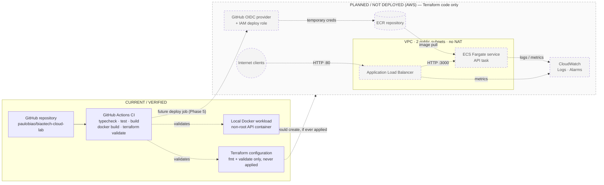

# Architecture

> **Status:** the AWS architecture is **designed in Terraform but NOT deployed**. No AWS resource exists. What is verified today is the local workload, the Terraform configuration (validated, never applied) and GitHub Actions CI. See [roadmap.md](roadmap.md) and [aws-zero-spend-guardrails.md](aws-zero-spend-guardrails.md).

## Goal

Run a small containerized HTTP API on AWS behind a load balancer, with the whole stack defined in Terraform and delivered by GitHub Actions authenticating to AWS through OIDC — no long-lived keys, no manual console changes, and everything destroyable on demand.

## Current vs planned

Solid boxes are **current and verified**. Dashed boxes inside the grey area are **planned and NOT deployed**; they exist only as Terraform code.



Planned request path: **Internet → ALB → ECS Fargate task → API**.
Planned delivery path: **GitHub → GitHub Actions → OIDC/IAM → ECR → ECS Fargate**.

## Components and why each exists

| Component | Terraform | Status | Why it is here |
|---|---|---|---|
| **TypeScript API** | — | ✅ Verified locally | Real workload: `/`, `/health`, `/ready`, JSON logs, graceful shutdown. |
| **Docker image** | — | ✅ Verified locally | Multi-stage, non-root; also verified with read-only root FS and all capabilities dropped. |
| **GitHub Actions CI** | — | ✅ Green on GitHub | Typecheck, tests, build, Docker build + smoke test, Terraform fmt/validate. No AWS access. |
| **Terraform** | `infra/terraform/` | ✅ Validated, ❌ never applied | Reproducible, reviewable, destroyable infrastructure; spend-gated by `acknowledge_aws_charges`. |
| **VPC + public subnets + IGW** | `network.tf` | ❌ Not deployed | Network for ALB and tasks across 2 AZs. No NAT gateway. |
| **Security groups** | `network.tf` | ❌ Not deployed | ALB: HTTP from allowed CIDRs. Tasks: container port from ALB SG only, HTTPS egress only. Default SG emptied. |
| **ECR** | `ecr.tf` | ❌ Not deployed | Private registry; immutable tags, scan on push, lifecycle policy. |
| **IAM task roles** | `iam.tf` | ❌ Not deployed | Execution role (pull image, write logs to one group); task role with no permissions. |
| **GitHub OIDC + deploy role** | `github_oidc.tf` | ❌ Not deployed | Keyless CI auth; trust restricted to `paulobiao/biaotech-cloud-lab` on `main`. |
| **ECS cluster / task def / service** | `ecs.tf` | ❌ Not deployed | Fargate 0.25 vCPU / 512 MiB, health check, awslogs, circuit-breaker rollback. |
| **Application Load Balancer** | `alb.tf` | ❌ Not deployed — **bills hourly** | Public entry point, `/ready` health checks, zero-downtime rolling deploys. |
| **CloudWatch** | `cloudwatch.tf` | ❌ Not deployed | Log group (7-day retention), 4 alarms on built-in metrics. |

## Networking decision: no NAT gateway

Fargate tasks are designed to run in **public subnets with a public IP**, with a security group that only accepts the container port from the ALB's security group and only allows HTTPS egress. This lets tasks pull from ECR and write to CloudWatch Logs without a NAT gateway, a large recurring cost (see [cost-strategy.md](cost-strategy.md)). The stricter private-subnet alternative is discussed in [security.md](security.md).

## Health model

- `GET /health` — **liveness**. Used by the Docker `HEALTHCHECK` and by the ECS container `healthCheck` in the task definition (ECS ignores the Dockerfile `HEALTHCHECK`).
- `GET /ready` — **readiness**. Returns `503` before listening and after `SIGTERM`. Used by the ALB target group health check, so a draining task stops receiving traffic.

On `SIGTERM` the API flips to not-ready, finishes in-flight requests and exits (forced after 10 s). The task definition gives it `stopTimeout = 30` before `SIGKILL`; the target group deregistration delay is 30 s.

> The ECS/ALB timing values are a reasoned design, **not production-validated**. They will be tested in Phase 7.

## Terraform layout

```
infra/terraform/
  versions.tf      Terraform + provider constraints
  providers.tf     AWS provider, region from variable, default tags
  variables.tf     inputs, incl. the acknowledge_aws_charges spend gate
  main.tf          locals (name prefix, tags)
  network.tf       VPC, subnets, IGW, routes, security groups
  ecr.tf           repository + lifecycle policy
  iam.tf           task execution role, task role
  github_oidc.tf   OIDC provider, deploy role + policy
  ecs.tf           cluster, task definition, service
  alb.tf           load balancer, target group, listener
  cloudwatch.tf    log group, alarms
  outputs.tf       ALB DNS, ECR URL, deploy role ARN
```

A **single flat root module** with one file per concern, not nested modules: one environment and one service means modules would add indirection without reuse. No account IDs, credentials or ARNs are hardcoded; the only data source is `aws_availability_zones`, to pick the first two AZs of the configured region.
